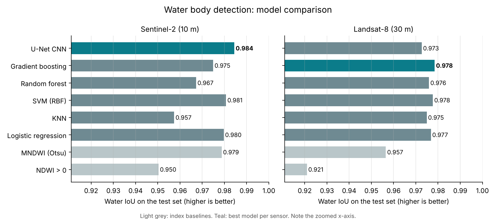

# Water Body Detection from Sentinel-2 and Landsat-8 Imagery

Pixel-level mapping of surface water from multispectral satellite imagery, comparing classical machine learning models against a CNN on two sensors: **Sentinel-2** (10 m) and **Landsat-8** (30 m).

> Originally built during my undergraduate studies. Rebuilt and extended in 2026 after the original codebase was lost.

## Problem

Mapping lakes, reservoirs and rivers is essential for water resource management, flood monitoring and drought assessment. Simple spectral indices like NDWI confuse water with shadows, dark roofs and wet soil. This project asks: **how much do learned models improve on index thresholds, and does a CNN that sees spatial context beat pixel-wise classifiers?**

## Data

| Sensor | Collection | Resolution | Bands used |
|---|---|---|---|
| Sentinel-2 | `COPERNICUS/S2_SR_HARMONIZED` (surface reflectance) | 10 m | B2, B3, B4, B8, B11, B12 |
| Landsat-8 | `LANDSAT/LC08/C02/T1_L2` (surface reflectance) | 30 m | SR_B2–SR_B7 |

Both sensors are mapped to a common set of bands: **blue, green, red, NIR, SWIR1, SWIR2**.

- **Imagery:** monthly cloud-masked median composites exported from Google Earth Engine (`gee/export_scenes.py`). Clouds are removed with the Sentinel-2 SCL band and the Landsat QA_PIXEL bits.
- **Labels:** [JRC Global Surface Water](https://global-surface-water.appspot.com/) Monthly History for the **same month** as the imagery (water / not water / no data). Cloud-masked pixels become "ignore".

## Features

Every model receives 10 features per pixel:

| Feature | Formula | Why |
|---|---|---|
| 6 reflectance bands | — | Raw spectral signature |
| NDWI | (Green − NIR) / (Green + NIR) | Classic water index |
| MNDWI | (Green − SWIR1) / (Green + SWIR1) | Suppresses built-up areas |
| NDVI | (NIR − Red) / (NIR + Red) | Separates vegetation |
| AWEI_sh | Blue + 2.5·Green − 1.5·(NIR + SWIR1) − 0.25·SWIR2 | Robust to shadows |

## Models

| Type | Model |
|---|---|
| Index baseline | NDWI > 0 |
| Index baseline | MNDWI with Otsu threshold |
| Classical ML (pixel-wise) | Logistic Regression |
| Classical ML (pixel-wise) | K-Nearest Neighbors |
| Classical ML (pixel-wise) | SVM (RBF kernel) |
| Classical ML (pixel-wise) | Random Forest |
| Classical ML (pixel-wise) | Gradient Boosting (HistGradientBoosting) |
| Deep learning | **CNN (U-Net)** on 128×128 tiles |

The CNN is an encoder-decoder with skip connections, trained with BCE + Dice loss (no-data pixels masked out), flip/rotation augmentation and early stopping on validation IoU.

## Evaluation design

- **Spatial split.** Scenes are cut into 128×128 tiles, and tiles are grouped into spatial blocks. Whole blocks go to train / val / test (70 / 15 / 15), so neighbouring, near-identical tiles cannot leak from training into testing.
- **Same test pixels for every model.** A fixed sample of up to 500k valid test pixels is scored for every model, including the CNN.
- **Metrics:** accuracy, precision, recall, F1, water IoU, Cohen's kappa. Because most pixels are land, accuracy alone is misleading; **IoU and F1 for the water class** are the main comparison metrics.

## Results

_Fill in from `results/comparison.md` after running the pipeline._

| Model | Sentinel-2 IoU | Sentinel-2 Acc | Landsat-8 IoU | Landsat-8 Acc |
|---|---|---|---|---|
| NDWI > 0 | | | | |
| MNDWI (Otsu) | | | | |
| Logistic Regression | | | | |
| KNN | | | | |
| SVM (RBF) | | | | |
| Random Forest | | | | |
| Gradient Boosting | | | | |
| **CNN (U-Net)** | | | | |

<!-- After running:  and a predictions/*_preview.png -->

## Project structure

```
water-body-detection/
├── gee/
│   └── export_scenes.py    # Earth Engine export: imagery + JRC labels
├── src/
│   ├── features.py         # Bands and water indices
│   ├── prepare_data.py     # Tiling and spatial train/val/test split
│   ├── common.py           # Shared test sample and metrics
│   ├── train_ml.py         # Baselines + 5 classical models
│   ├── cnn.py              # U-Net architecture
│   ├── train_cnn.py        # CNN training and test evaluation
│   ├── compare.py          # Comparison table and chart
│   └── predict_scene.py    # Full-scene water mask (GeoTIFF + preview)
└── requirements.txt
```

## How to run

```bash
pip install -r requirements.txt

# 1. Export scenes from Earth Engine (needs a free Earth Engine account).
#    Use several areas with different water types: lakes, rivers, reservoirs, coast.
earthengine authenticate
python gee/export_scenes.py --project YOUR_GEE_PROJECT --name hyderabad \
    --bbox 78.25 17.25 78.60 17.55 --year 2021 --month 3 --sensor both
#    Download the GeoTIFFs from Google Drive into data/raw/sentinel2/ and data/raw/landsat8/

# 2. Tile and split
python -m src.prepare_data --sensor sentinel2
python -m src.prepare_data --sensor landsat8

# 3. Classical models and baselines
python -m src.train_ml --sensor sentinel2
python -m src.train_ml --sensor landsat8

# 4. CNN (GPU recommended: Google Colab or Kaggle)
python -m src.train_cnn --sensor sentinel2
python -m src.train_cnn --sensor landsat8

# 5. Compare everything
python -m src.compare

# 6. Map water across a full scene
python -m src.predict_scene data/raw/sentinel2/<scene>.tif --model models/sentinel2/cnn_unet.pt
```

## Limitations

- JRC labels are themselves derived from Landsat, so they are a strong reference but not hand-annotated ground truth. Small ponds and narrow rivers below 30 m are under-represented.
- JRC monthly history currently runs to 2021, which sets the latest usable month.
